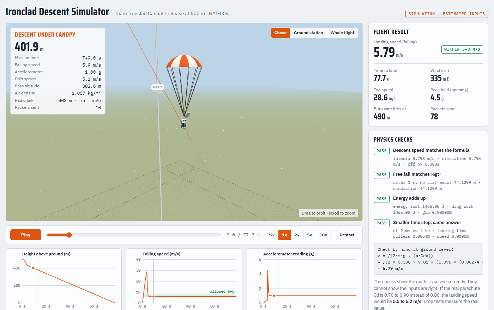

# Team Ironclad CanSat

A reusable CanSat that measures PM2.5 air pollution from 500 m down to the ground,
sends the data live to a laptop, and lands safely so it can fly again.

**SEVA FIRST Innovation Challenge 2026 · NAT-004 · Oakridge International School, Gachibowli, Hyderabad**

## Try the simulation
- **3D descent simulator (runs in your browser):** https://SishirKotra.github.io/ironclad-cansat/
- **Colab notebook:** [open in Google Colab](https://colab.research.google.com/github/SishirKotra/ironclad-cansat/blob/main/simulation/ironclad_descent.ipynb)
- **Flight logic:** [`firmware/flight_logic.ino`](firmware/flight_logic.ino), ESP32-C3 code for fall detection, burn wire, telemetry and landing beeps

## Status
Design and simulation stage. **Hardware not built yet.**
All results below are simulated, using estimated inputs (300 g mass, 50 cm parachute, Cd 0.8).

| Result (3D simulator, 30 °C, 3 m/s wind) | Value |
|---|---|
| Landing speed | 5.79 m/s (rule: 5 to 8 m/s) |
| Time from 500 m to ground | 77.7 s |
| Wind drift | 335 m |
| Top speed before the parachute opens | 28.6 m/s |
| Peak load when the parachute opens | 4.5 g |
| Telemetry packets (1 per second) | 78 |

The 3D simulator checks itself every time an input changes:

- the descent speed matches v = √(2mg ÷ ρCdA)
- free fall with no air matches ½gt²
- the energy balances
- halving the time step gives the same answer

The Colab notebook uses a simpler model (fixed air density, no wind on the fall), so it gives 5.7 m/s.

## How it works
- **Sensors:** PMS5003 (PM2.5), BME280 (pressure, temperature, humidity), NEO-6M GPS
- **Brain:** ESP32-C3 logs to a microSD card and sends data by LoRa radio (865–867 MHz) once a second
- **Parachute release:** the ESP32 detects the fall and heats a nichrome wire that cuts a thread; a spring opens the lid
- **Landing:** open PLA rib-cage frame with a TPU crush ring underneath; a buzzer helps find it
- **Power:** 1S 360 mAh LiPo with a 5 V boost board for the PMS5003 fan

## Folders
| Folder | Contents |
|---|---|
| `simulation/` | 3D simulator, Colab notebook, graph, simulated telemetry |
| `firmware/` | Flight logic: fall detection → burn wire → descent → landing beeps |
| `cad/` | v2 concept model (STEP), renders and the script that builds it. Fixes in progress: removable decks, working hinge, spring |
| `analysis/` | FEA results and our analysis of 2024–25 Hyderabad CPCB/TSPCB station data |
| `bom/` | Bill of materials (₹10,711) and weight budget (700 g limit) |
| `docs/` | Evidence appendix |

## What the simulation leaves out
The CanSat is treated as a point (no swinging), the parachute opens at an even rate,
wind is steady, and drag coefficients are estimates. Drop tests will give the real values.

## Team
Sishir Kotra (lead) · Dhanush Musunuru · Mentor: Agin M (Oakridge, ATL Mentor of Change)

## Sources
- ESA Teach with Space T10, *Design your parachute*
- Station data: CPCB/TSPCB via data.opencity.in
- Barkjohn et al., AMT 2021 (PurpleAir correction); Campmier et al., AMT 2023 (low-cost sensor accuracy)
- Ahlawat et al., npj Clean Air 2026, doi:10.1038/s44407-025-00044-3

## Licence
Code: MIT (see `LICENSE`). Data analysis and documents: CC BY 4.0.
